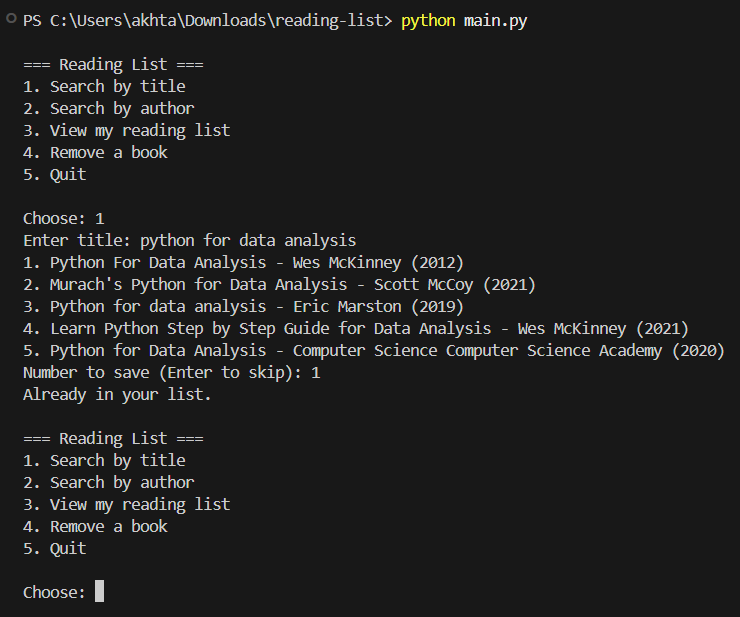

# Reading List App

A command-line interface (CLI) application that allows users to search for books by **title** or **author** using live data from the [Open Library API](https://openlibrary.org/developers/api) and manage a persistent personal reading list stored in a JSON file.

---

## 🎯 Project Objectives
- **Interactive CLI**: Create a user-friendly terminal interface for book discovery and management.
- **External API Integration**: Fetch live book information asynchronously from Open Library without requiring an API key.
- **Data Persistence**: Store, read, and update saved reading list data locally in a structured JSON file (`reading_list.json`).
- **Data Integrity**: Validate input and prevent duplicate book entries using unique work identifiers.

---

## ✨ Features
- **Live Search**: Query books by title or author name and display relevant details (title, authors, first publication year).
- **Persistent Reading List**: Save favorite books to a local `reading_list.json` file that persists between sessions.
- **Duplicate Prevention**: Automatically checks whether a book already exists in your list before saving.
- **List Management**: View all saved books at any time or remove items using their list number.

---

## 🛠️ Technologies & Libraries Used
- **Python 3**: Core programming language.
- **`requests`**: Third-party HTTP library used to communicate with the Open Library REST API.
- **`json`**: Standard library module for serializing and deserializing the reading list file.
- **`os`**: Standard library module for file path and existence checks.
- **[Open Library Search API](https://openlibrary.org/developers/api)**: Free, open public API for querying book data.

---

## 📁 Project Structure
```text
Reading-List-App/
├── api.py              # API functions to query Open Library
├── main.py             # CLI menu loop and user interaction logic
├── storage.py          # JSON reading list file operations (add, remove, load)
├── requirements.txt    # Project dependencies (requests)
├── .gitignore          # Git ignore rules (.venv, __pycache__, etc.)
├── README.md           # Project documentation and guide
└── screenshot.png      # Application execution screenshot
```

---

## 🚀 How to Run the Code

### Prerequisites
- Python 3.8 or higher installed on your computer.

### 1. Clone the Repository
```bash
git clone https://github.com/Mubashir-Ul-Hassan/Reading-List-App.git
cd Reading-List-App
```

### 2. Create and Activate a Virtual Environment

**Windows:**
```powershell
python -m venv .venv
.venv\Scripts\activate
```

**macOS / Linux:**
```bash
python3 -m venv .venv
source .venv/bin/activate
```

### 3. Install Required Dependencies
```bash
pip install -r requirements.txt
```

### 4. Run the Application
```bash
python main.py
```

---

## 📸 Demo & Sample Output



### Terminal Example:
```text
=== Reading List ===
1. Search by title
2. Search by author
3. View my reading list
4. Remove a book
5. Quit

Choose: 1
Enter title: the hobbit
1. The Hobbit - J.R.R. Tolkien (1937)
2. The Hobbit Companion - David Day (1975)
Number to save (Enter to skip): 1
Saved: The Hobbit
```

### Saved Data Structure (`reading_list.json`):
```json
[
  {
    "key": "/works/OL262758W",
    "title": "The Hobbit",
    "author": "J.R.R. Tolkien",
    "year": 1937
  }
]
```
